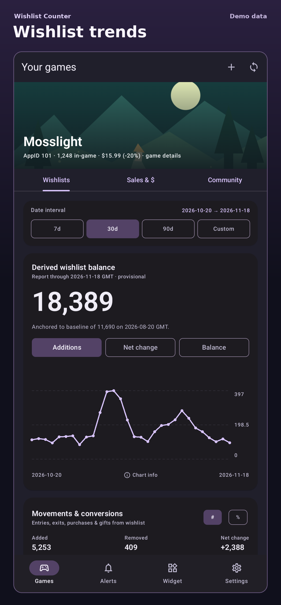
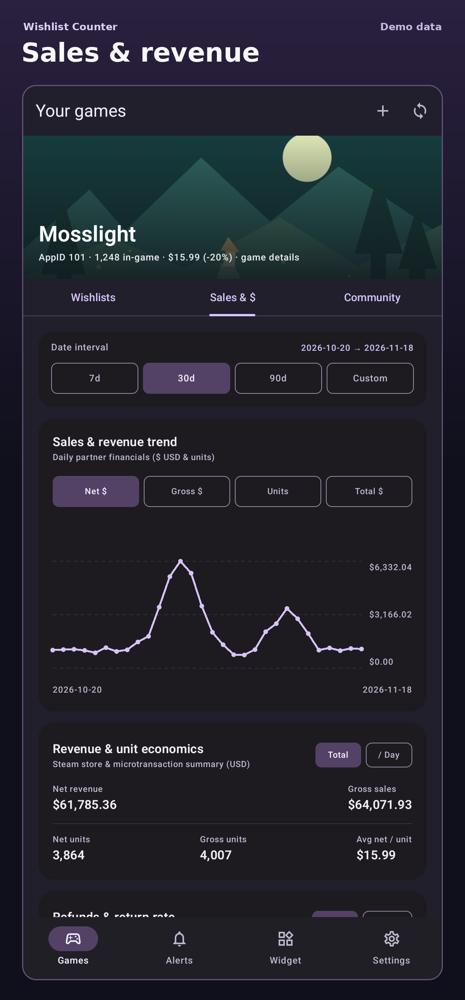
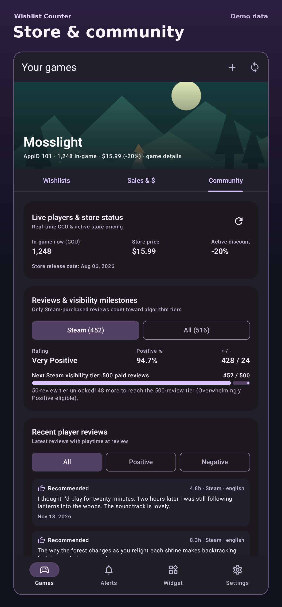

# Wishlist Counter

Open-source Android companion for Steamworks developers. Built with native Kotlin and Jetpack Compose around the **Focus** design language, supporting system, light, and dark themes with zero proprietary SDKs or telemetry.

> **Disclaimer**: Unofficial tool for game developers. Not affiliated with, endorsed, or sponsored by Valve Corporation.

## Screenshots

The Android app in dark mode, with demo data for Mosslight.

<p align="center">
  <a href="docs/screenshots/01-wishlist-trends.png"></a>
  <a href="docs/screenshots/02-sales-and-revenue.png"></a>
  <a href="docs/screenshots/03-store-and-community.png"></a>
</p>

## Views & Metrics

Each monitored game provides a unified date interval selector (`7d`, `30d`, `90d`, `Custom`) across three dedicated views:

1. **Wishlists**
   - **Trend & Derived Balance**: Interactive chart (`Additions`, `Net change`, `Balance`) with tap/drag day inspection, automatic cumulative balance from cached reports, and optional manual baseline anchoring (backwards and forwards).
   - **Movements & Conversions**: Additions, removals, purchases, gifts, net change, and conversion rate (`#` vs `%`).
   - **Geographic & Language Reach**: Top countries and client languages (`country_summary` / `language_summary`) for localization planning.
   - **Platform & Steam Deck Interest**: Wishlist additions split across Windows, Linux / SteamOS (Deck), and macOS.
2. **Sales & Revenue ($)**
   - **Sales & Revenue Trend**: Interactive chart for `Net $`, `Gross $`, `Units`, and `Total $` powered by `IPartnerFinancialsService/GetDetailedSales`.
   - **Revenue & Unit Economics**: Interval totals and daily averages for gross/net revenue (USD), gross/net units, and Average Selling Price (`Avg net / unit`).
   - **Refunds & Return Rate**: Returned units, refunded USD, and refund rate percentage with health status indicator.
   - **CD-Key & Retail Activations**: External key redemptions vs direct Steam store units.
3. **Store & Community**
   - **Live Players & Store Status**: Real-time concurrent players (`CCU`), current store price, active discount badge, and release date.
   - **Reviews & Visibility Milestones**: Tracks Steam-purchased reviews vs key reviews with a progress bar toward Steam's algorithmic visibility tiers (`10 → 50 → 500 → 1,000` paid reviews).
   - **Recent Player Reviews**: Filterable (`All`, `Positive`, `Negative`) feed showing review text, playtime at review, purchase type, and language.
   - **Player Progression Funnel**: Global achievement unlock percentages (`Top` vs `Rarest`).

## Build

Requires JDK 17 and the Android SDK (`platforms;android-35`, `build-tools;35.0.0`):

```sh
./gradlew :app:assembleDebug :app:testDebugUnitTest :app:lintDebug
```

The debug APK is generated at `app/build/outputs/apk/debug/app-debug.apk`. Android 8.0 (API 26) or newer is required.

## Privacy & Security

- **Local-first**: All cached reports, preferences, and credentials stay on your device. No analytics, telemetry, Firebase, or Google Play Services are included.
- **Hardware-backed encryption**: Your Steamworks Financial API key is encrypted with AES-GCM via the Android Keystore and sent exclusively over HTTPS to `partner.steam-api.com` using the `x-webapi-key` header.
- **Backups disabled**: Android cloud and device-to-device backups are disabled in `AndroidManifest.xml` to prevent key or financial data extraction.

## License

Released under the [MIT License](LICENSE).
